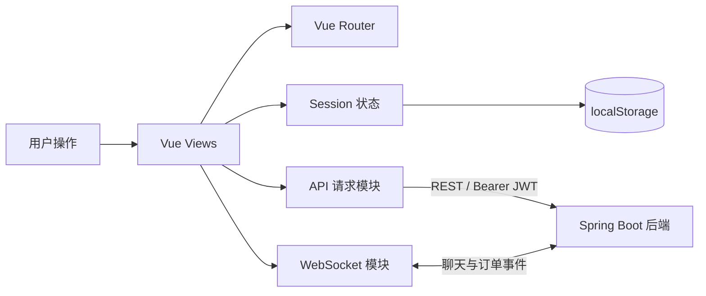

# 智能校园二手交易平台前端开源文档

> 基于 Vue 3、TypeScript 和 Vite 开发的校园二手交易平台前端，覆盖商品浏览、发布、收藏、即时聊天、订单支付、退货评价、举报中心和管理后台等完整页面。

[](https://vuejs.org/)
[](https://www.typescriptlang.org/)
[](https://vite.dev/)
[](https://router.vuejs.org/)
[](https://github.com/xjlznb66/second-handTradingPlatform)

## ☀️ 新手必读

- 推荐仓库名称：`second-hand-trading-platform-frontend`。
- 项目使用 **Vue 3 + TypeScript + Vite**，不是 Vue 2 项目。
- `package.json` 要求 Node.js `^22.18.0 || >=24.12.0`，Node 版本过低会导致依赖安装或构建失败。
- 前端默认请求 `http://localhost:8081`，请先启动配套 Spring Boot 后端。
- 项目使用浏览器原生 Fetch API 请求后端，没有引入 Axios。
- 页面样式由项目原生 CSS 实现，没有依赖 Element Plus 等 UI 组件库。
- 登录 Token 保存在 `localStorage`，开发调试时请勿提交真实账号或密钥。

## ☀️ 项目介绍

**智能校园二手交易平台前端**面向高校学生的闲置物品交易场景，提供从商品发现、沟通咨询、下单支付到售后评价的完整用户界面。系统同时提供管理员工作台，用于商品审核、用户治理、分类维护、举报处理和订单查询。

前端采用 Vue 3 Composition API 编写，使用 Vue Router 管理页面路由，通过统一请求模块封装 REST API，通过 WebSocket 接收聊天消息和订单状态变化。项目保持依赖精简，便于学习、二次开发和毕业设计展示。

- **前端默认地址**：通常为 `http://localhost:5173`
- **后端默认地址**：`http://localhost:8081`
- **后端仓库**：[second-handTradingPlatform](https://github.com/xjlznb66/second-handTradingPlatform)
- **接口文档**：`http://localhost:8081/swagger-ui.html`

## ☀️ 功能和特性

### 用户端功能

1. **首页展示**：展示平台介绍、热门商品、最新商品和分类入口。
2. **注册登录**：支持账号注册、登录、登录状态保存和退出登录。
3. **商品列表**：支持关键词、分类、价格区间、商品状态和排序条件查询。
4. **商品详情**：展示图片、价格、库存、卖家、商品描述、交易信息和用户评价。
5. **商品发布**：填写商品信息、库存、交易方式和联系方式，并上传商品图片。
6. **我的商品**：管理本人发布的商品，支持编辑、上架和下架。
7. **商品收藏**：收藏或取消收藏商品，并在收藏页面集中查看。
8. **即时消息**：创建商品咨询会话，查看历史消息并实时发送、接收聊天内容。
9. **订单中心**：从买家或卖家视角查询订单，完成支付、确认、完成和取消操作。
10. **退货售后**：发起退货申请，处理同意、驳回和完成退货流程。
11. **交易评价**：交易完成后提交评分与评价，卖家可以追加回复。
12. **收货地址**：新增、编辑、删除地址，并设置默认收货地址。
13. **个人中心**：修改头像、昵称、手机号、学号、专业和年级等资料。
14. **举报中心**：提交商品或用户举报，查看本人举报记录和处理状态。

### 管理端功能

1. **商品审核**：查看待审核商品并执行通过或驳回操作。
2. **用户管理**：查询用户资料、角色和状态，并进行账号治理。
3. **举报管理**：集中查看举报记录，填写处理结果并更新状态。
4. **分类管理**：新增、编辑和删除商品分类。
5. **订单管理**：查询平台订单列表和订单详情。

### 项目特性

1. **TypeScript 类型约束**：集中维护接口响应、商品、订单、聊天和用户等数据类型。
2. **统一请求封装**：统一处理 API 地址、JSON 请求头、JWT Token、业务错误和 HTTP 错误。
3. **路由权限守卫**：需要登录的页面自动检查 Token，未登录时跳转登录页并保留原访问地址。
4. **实时通信**：通过 WebSocket 接收聊天消息、离线消息重放和订单状态事件。
5. **自动重连**：WebSocket 非主动断开时每 2 秒尝试重新连接。
6. **订单幂等键**：创建订单前生成幂等标识，防止重复点击或网络重试造成重复订单。
7. **支付状态轮询**：跳转支付宝付款后查询支付结果并刷新订单状态。
8. **响应式界面**：使用原生 CSS Grid、Flex 和媒体查询适配不同屏幕宽度。

## ☀️ 项目详细介绍（亮点）

项目不是只有首页和商品列表的展示模板，而是已经连接真实后端接口的完整业务前端。登录认证、商品状态、订单操作、支付结果、聊天消息和管理员操作均由后端数据驱动。

### ⭐ 首页模块功能介绍

1. **平台入口**：通过首页快速进入商品列表、发布商品和个人功能页面。
2. **商品展示**：请求商品分页接口，展示平台中的最新或热门商品。
3. **分类导航**：加载后端分类数据，帮助用户快速筛选目标商品。
4. **状态联动**：导航栏根据登录状态展示登录入口或个人功能菜单。

### ⭐ 注册登录模块功能介绍

1. **表单切换**：同一视图根据路由展示登录或注册表单。
2. **登录状态保存**：登录成功后保存 Token 和用户信息，刷新页面后仍能识别状态。
3. **登录后跳转**：访问受保护页面时记录目标地址，登录成功后返回原页面。
4. **退出登录**：清除本地会话数据并关闭 WebSocket 连接。

### ⭐ 商品列表模块功能介绍

1. **关键词搜索**：根据商品标题或内容关键词查询商品。
2. **组合筛选**：支持分类、价格区间、卖家和商品状态筛选。
3. **多种排序**：支持最新发布和热门程度排序。
4. **分页加载**：按页请求数据，避免一次加载全部商品。

### ⭐ 商品详情模块功能介绍

1. **商品展示**：展示图片、标题、价格、库存、描述和交易信息。
2. **创建订单**：选择数量和收货地址后创建订单，并生成唯一幂等键。
3. **联系卖家**：创建或复用聊天会话，并跳转消息页面。
4. **评价展示**：分页加载历史评分和评价。
5. **举报入口**：针对商品或卖家提交举报信息。

### ⭐ 商品发布与管理模块功能介绍

1. **发布表单**：填写分类、标题、价格、库存、描述、交易地点和联系方式。
2. **图片上传**：商品创建后上传图片，支持设置封面和排序。
3. **编辑商品**：复用发布表单更新已有商品信息。
4. **上下架管理**：在“我的商品”页面控制商品上架或下架。
5. **状态展示**：展示草稿、待审核、上架、下架或已售出状态。

### ⭐ 收藏模块功能介绍

1. **收藏列表**：分页查看当前用户收藏的全部商品。
2. **取消收藏**：在列表中直接取消收藏并更新页面。
3. **详情跳转**：点击收藏项进入商品详情继续查看或购买。

### ⭐ 即时消息模块功能介绍

1. **会话列表**：分页获取与不同商品、不同用户建立的聊天会话。
2. **聊天记录**：选择会话后加载历史消息并更新已读状态。
3. **实时收发**：WebSocket 连接正常时直接发送并接收聊天消息。
4. **离线重放**：处理 `message-replay` 事件，补充待接收消息。
5. **断线重连**：网络中断后自动尝试恢复连接。

### ⭐ 收货地址模块功能介绍

1. **地址列表**：展示当前用户保存的全部收货地址。
2. **新增与编辑**：维护收货人、手机号、省市区和详细地址。
3. **默认地址**：一键设置默认地址，创建订单时优先选择。
4. **删除地址**：删除不再使用的地址并刷新列表。

### ⭐ 订单模块功能介绍

1. **双重视角**：根据买家或卖家身份切换订单列表。
2. **状态筛选**：筛选待支付、交易中、已完成或已取消订单。
3. **支付方式**：支持模拟支付和支付宝电脑网站支付。
4. **订单操作**：支持确认订单、完成交易和取消订单。
5. **退货处理**：提交退货原因，执行同意、驳回和完成售后。
6. **评价与追评**：买家提交评价，卖家追加回复。
7. **实时更新**：接收 `order-status` 事件后刷新订单状态。

### ⭐ 个人中心模块功能介绍

1. **资料展示**：加载当前用户头像、昵称、账号和校园信息。
2. **资料编辑**：修改手机号、学号、性别、专业和年级。
3. **密码修改**：提交原密码和新密码完成安全更新。
4. **功能导航**：进入我的商品、订单、收藏、地址和消息页面。

### ⭐ 举报中心模块功能介绍

1. **提交举报**：选择举报目标和类型，填写原因与详细说明。
2. **记录查询**：分页查询本人提交的举报。
3. **状态展示**：展示举报进度和管理员处理结果。

### ⭐ 管理后台模块功能介绍

1. **商品审核**：查看商品并提交审核状态和驳回原因。
2. **用户治理**：查询用户并修改角色、状态和基础资料。
3. **分类维护**：创建、修改和删除商品分类。
4. **举报处理**：更新举报状态并记录处理结果。
5. **订单查询**：根据订单号、用户、商品或状态筛选订单。

## ☀️ 快速运行

### 环境要求

| 环境 | 版本 |
| :--- | :--- |
| Node.js | `^22.18.0 || >=24.12.0` |
| npm | 随 Node.js 安装的稳定版本 |
| 浏览器 | Chrome、Edge、Firefox 等现代浏览器 |
| 后端服务 | 默认 `http://localhost:8081` |

### 1. 安装依赖

```shell
npm install
```

### 2. 配置后端地址

项目默认请求 `http://localhost:8081`。需要修改时，在根目录创建 `.env.local`：

```dotenv
VITE_API_BASE_URL=http://localhost:8081
```

> 不要在 `VITE_*` 变量中存放密码、私钥等敏感信息，这些变量会被打包到浏览器代码中。

### 3. 启动开发服务器

```shell
npm run dev
```

启动后根据终端提示打开页面，默认通常为 `http://localhost:5173`。

### 4. 前后端联调

1. 确认后端以及 MySQL、Redis、RabbitMQ 已启动。
2. 打开前端注册页面创建账号并登录。
3. 登录后 Token 会自动添加到后续 API 请求。
4. 请求失败时使用浏览器开发者工具查看 Network 响应。

## ☀️ 技术选型

| 技术 | 作用 | 版本 |
| :--- | :--- | :--- |
| Vue | 页面和响应式状态 | 3.5.40 |
| Vue Router | 路由、页面标题和登录守卫 | 4.5.1 |
| TypeScript | 数据类型与接口约束 | 6.0.0 |
| Vite | 开发服务器与生产构建 | 8.1.5 |
| Vue TSC | Vue TypeScript 类型检查 | 3.3.7 |
| Fetch API | REST 请求 | 浏览器原生 |
| WebSocket | 聊天和订单实时事件 | 浏览器原生 |
| CSS Grid / Flex | 页面布局和响应式适配 | 浏览器原生 |

## ☀️ 前端架构



## ☀️ 页面路由

| 页面 | 路由 | 登录要求 |
| :--- | :--- | :---: |
| 首页 | `/` | 否 |
| 商品列表 | `/products` | 否 |
| 商品详情 | `/products/:id` | 否 |
| 登录 / 注册 | `/login`、`/register` | 否 |
| 发布商品 | `/publish` | 是 |
| 我的商品 | `/my-products` | 是 |
| 个人中心 | `/profile` | 是 |
| 收货地址 | `/addresses` | 是 |
| 即时消息 | `/messages` | 是 |
| 订单中心 | `/orders` | 是 |
| 商品收藏 | `/favorites` | 是 |
| 举报中心 | `/reports` | 是 |
| 管理后台 | `/admin` | 是 |

## ☀️ 项目结构

```text
fronter/
├─ public/                    # 公共静态资源
├─ src/
│  ├─ assets/                # 全局样式和图片资源
│  ├─ components/            # 通用组件
│  ├─ layouts/SiteLayout.vue # 站点公共布局和导航
│  ├─ lib/
│  │  ├─ api.ts              # 业务 API 方法
│  │  ├─ http.ts             # Fetch 请求和 Token 封装
│  │  ├─ realtime.ts         # WebSocket 连接与订阅
│  │  ├─ session.ts          # 登录会话状态
│  │  ├─ order.ts            # 订单幂等键工具
│  │  ├─ image.ts            # 图片地址处理
│  │  └─ format.ts           # 金额、时间和状态格式化
│  ├─ router/index.ts        # 路由与登录守卫
│  ├─ types/api.ts           # API 数据类型
│  ├─ views/                 # 页面视图
│  ├─ App.vue                # 应用入口组件
│  └─ main.ts                # Vue 初始化入口
├─ package.json
└─ vite.config.ts
```

## ☀️ 请求与认证

所有请求通过 `src/lib/http.ts` 统一发送：

```http
Authorization: Bearer <JWT_TOKEN>
Content-Type: application/json
```

请求模块统一处理 API 地址、Token、JSON 数据、业务错误、HTTP 错误和图片上传请求。

## ☀️ WebSocket 实时通信

登录后应用自动连接：

```text
ws://localhost:8081/ws/chat?token=<JWT_TOKEN>
```

| 事件 | 作用 |
| :--- | :--- |
| `message` | 接收一条新聊天消息 |
| `message-replay` | 重放离线或待接收消息 |
| `order-status` | 接收订单状态变化 |
| `error` | 展示实时连接业务错误 |

## ☀️ 构建与部署

```shell
npm run build
```

该命令会执行 Vue TypeScript 类型检查和 Vite 生产构建，产物输出到 `dist/`。

```shell
npm run type-check
npm run preview
```

项目使用 `createWebHistory`，Nginx 部署时需要配置路由回退：

```nginx
location / {
    try_files $uri $uri/ /index.html;
}
```

## ☀️ 常见问题

### Node 版本错误

升级到 Node.js 22.18 或符合 `package.json` 要求的更高版本，然后重新安装依赖。

### 页面能打开但接口失败

检查后端是否启动，以及 `VITE_API_BASE_URL` 是否正确。修改环境变量后需要重启 Vite。

### 接口返回 401

重新登录并检查 `localStorage` 中是否存在 `auth-token`。后端 JWT 密钥变化后旧 Token 会失效。

### WebSocket 连接失败

检查后端 `/ws/chat`、Token 和反向代理的 WebSocket Upgrade 配置。

### 刷新子页面出现 404

生产服务器需要配置 History 路由回退，将未知静态路径返回 `index.html`。

### 图片无法显示

检查后端图片地址、OSS 访问权限或本地 `/uploads/**` 静态资源映射。

## ☀️ 贡献指南

1. Fork 前端仓库。
2. 创建功能分支：`git checkout -b feature/AmazingFeature`。
3. 完成功能后执行 `npm run build`。
4. 提交修改并推送分支。
5. 创建 Pull Request，并说明功能和验证方式。

如果这个项目对你有帮助，欢迎点一个 Star ⭐。
